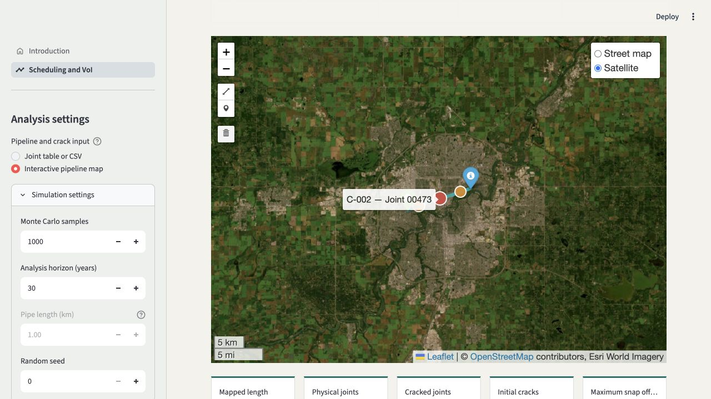

# Pipeline Scheduling and Value of Information Lab

This folder is a self-contained Streamlit demonstration comparing the optimized
J3 ILI schedule with a prior excavation schedule adapted from
`System_regular_repair.py` and `optimize_regular_repair.py`.

The comparison uses common pipe, crack, deterioration, cost, and Monte Carlo
inputs, with separate candidate ranges for prior excavation and ILI inspection
intervals. For each method, the recommended interval is the lowest-cost
candidate that satisfies both safety criteria. An unsafe candidate is never
presented as the optimum. It reports net VoI as:

`minimum safe prior excavation cost - minimum safe ILI-informed cost`

Click any cost-curve point to see the interval's total cost, failure cost
(`Cf`), repair cost (`Cr`), and its **Safe** or **Unsafe** status.

## Pipeline class and safety criteria

The scheduling page applies separate maximum annual probabilities of failure
for leakage (`PfL`) and burst (`PfB`). The four built-in study presets use the
requested one-order-of-magnitude progression:

| Class | Maximum PfL | Maximum PfB |
|---|---:|---:|
| Class 1 | `1e-2` | `1e-3` |
| Class 2 | `1e-3` | `1e-4` |
| Class 3 | `1e-4` | `1e-5` |
| Class 4 | `1e-5` | `1e-6` |

These values are transparent **study assumptions**, not a claim that CSA Z662
prescribes this exact PfL/PfB table. CSA research describes consequence-based
safety classes and risk-consistent safety factors, while published reliability
research supports increasingly stringent reliability with higher class
location but reports class- and pipeline-dependent implied probabilities:

- [CSA Group: Development of a risk-consistent safety class system](https://www.csagroup.org/wp-content/uploads/CSA-Group-Research-Pipeline-Safety-Factors-Exec-Summary.pdf)
- [Zhou, Siraj, and Gong (2015), DOI 10.1139/cjce-2015-0232](https://doi.org/10.1139/cjce-2015-0232)

A **User-defined** option is also available. The selected limits are applied to
both the prior and ILI-informed schedules and are shown on the annual POF plots.

The results distinguish the lowest-cost tested interval from the lowest-cost
safe interval. The lowest-cost interval is always shown together with its
Safe/Unsafe status. If the tested range contains no safe interval, the safe
interval is shown as **Not found** rather than hiding the cost optimum.

## Start locally

On macOS, double-click `run_app.command`. On Windows, double-click
`run_app.bat`. The first start creates a private Python environment and installs
the packages in `requirements.txt`.

The application opens on a separate **Introduction** page. Use the navigation
menu to open **Scheduling and VoI**.

The scheduling sidebar uses collapsible sections for simulation settings,
pipeline class and safety, separate prior excavation and ILI inspection
intervals, initial cracks and crack initiation, crack growth, the ILI
measurement model (POD and sizing
errors), repair criteria, repair effectiveness, and costs.

The ILI measurement section offers two probability-of-detection models:

- **Depth only:** `POD = 1 - exp(-qd × depth)` (the original behavior).
- **Depth and length:** `POD = 1 - exp[-(qd × depth + qL × length)]`.

Both coefficients are user inputs in inverse millimetres. The depth-and-length
form is a simple monotonic screening model, not a universal ILI-tool curve;
calibrate `qd` and `qL` using vendor qualification, dig, or excavation data.
The choice to include both dimensions is supported by a field UT-ILI study
reporting that SCC detection increases with maximum depth and longest
interacting length: [Lu, Skow, and Keane (2014)](https://www.cfertech.com/2014/09/29/assessing-the-probability-of-detecting-crack-features-using-ultrasonic-in-line-inspection-tool-run-results-and-excavation-data/).

## Interactive pipeline map

Select **Interactive pipeline map** under **Pipeline and crack input** to use a
mapped route instead of entering the pipe length manually. The map provides
street and satellite layers and tools for drawing a pipeline centreline and
placing crack markers.

Use either of these methods to locate a crack:

- **Click on the map:** enter the next crack depth and length, select the map's
  marker tool, and click on or near the pipeline. The app snaps the marker to
  the closest point on the centreline.
- **Enter distance from pipeline start:** enter the crack chainage in
  kilometres and select **Add crack at this distance**. The app places the
  crack exactly on the route at that distance.

The green map marker defines chainage `0 km`; the blue marker is the pipeline
end. The **Crack locations on the pipeline** table reports every crack's
distance from the start, assigned joint, depth, length, and original click
offset. Coordinates remain available in a separate advanced editor but are not
required for normal use.

For each marker, the app:

1. snaps the selected point to the nearest route segment;
2. calculates its distance along the pipeline (chainage);
3. assigns it to a physical joint using the user-entered nominal joint length;
4. combines multiple cracks that fall on the same joint; and
5. represents all remaining crack-free joints as one counted group.

The mapped length automatically replaces the manual `pipe_length_km` value in
the cost and risk model. The included Edmonton route and defects are synthetic
demonstration data, not an operating pipeline alignment.

## ILI inspection cost

The **ILI inspection cost per km per event ($M/km)** input is a rate, not a
per-joint cost. At every scheduled ILI year, the model adds:

`inspection cost per km × mapped/manual pipeline length ÷ (1 + discount rate)^year`

For example, an input of `0.01` for a 10 km pipeline costs `$0.10M` for each
ILI event before discounting. The cost is included only in the ILI-informed
schedule and is charged once per ILI event, regardless of the number of joints.

## Edit the introduction page

- Edit `content/ABSTRACT.md` to change the short abstract.
- Edit `content/DOCUMENTATION.md` to change the explanation and documentation.
- Replace the files in `assets/` to update the two portraits or university logo.

The scheduling interface remains in `inspection_planner.py`; the shared
simulation logic is in `Simp_Sys_Thresh_J3_optimized.py`, and the pure
optimization/VoI helpers are in `planning_analysis.py`. The GIS geometry and
map-to-joints transformer are in `pipeline_map.py`. The small
`streamlit_app.py` file only configures navigation, so the Streamlit Community
Cloud entry point remains unchanged.

See [`docs/INTRODUCTION_PAGE_SETUP.md`](docs/INTRODUCTION_PAGE_SETUP.md) for the
step-by-step implementation and editing workflow.

## Joint/crack CSV

Use one row for each unique joint or statistically identical joint group:

- `joint_id`: unique display name.
- `count`: number of statistically identical joints represented by the row.
- `num_cracks`: number of initial cracks in each represented joint.
- `mean_lengths_mm`: semicolon-separated mean initial crack lengths.
- `mean_depths_mm`: semicolon-separated mean initial crack depths.
- `WT_mean`, `WT_std`: wall-thickness distribution.
- `Pservice_mean`, `Pservice_std`: service-pressure distribution.
- `birth_rate`: optional joint-specific crack-initiation rate in cracks per
  joint-year. Leave it blank to use the **Crack birth rate** entered in the
  sidebar. The simulation treats initiation as a Poisson process, so a rate of
  `0.01` means one new crack per 100 joint-years on average.

For zero initial cracks, set `num_cracks` to zero and leave both size fields
blank. Additional property columns can be supplied using the pattern
`PROPERTY_mean`, `PROPERTY_std`, and `PROPERTY_distribution`, where PROPERTY is
one of `alpha`, `WT`, `Neq`, `C`, `SMYS`, `SMTS`, `CVN`, `E`, `err`, or
`Pservice`.

## Public deployment

1. Put this folder in a GitHub repository.
2. Create an app at https://share.streamlit.io.
3. Select the repository and `streamlit_app.py` as the entrypoint.
4. Make the app public and copy its stable `streamlit.app` URL.

The default one-joint, 1,000-sample example is intended for an interactive
demonstration. Large numbers of individually different joints require
proportionally more computation; use the `count` column for identical groups.
